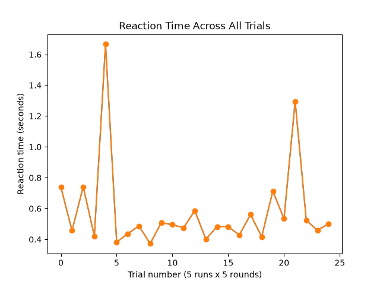

# Reaction Time Test

A command-line reaction time test written in Python. It waits a random amount of time, tells you to press Enter, measures how fast you respond over 5 rounds, catches false starts, and saves your results to a CSV file.

This is Week 1 of **Project MOVE**, my 8-week plan to learn the technical skills behind interactive, adaptive systems for rehabilitation.

## Why I built this

I'm interested in how technology can support movement and recovery: assistive technology, HCI, and rehabilitation. My long-term goal is a gamified physical therapy prototype, a game that responds to how a person moves.

Before I could build anything like that, I needed to understand the simplest loop behind any interactive system: **input → processing → output**. A reaction time test is the smallest version of that loop. The system gives a cue, the person responds, and the program measures the response and gives feedback.

It is also where I started thinking about what "adaptive" means. A person's performance is not fixed. It changes from round to round and from day to day. Good therapy should not give everyone the same exercise; the challenge should meet the person where they are right now. 

## How it works

1. Print `Get ready...` and wait a random 2–5 seconds (`time.sleep(random.uniform(2, 5))`).
2. Print `Go!` and start the timer (`time.perf_counter()`).
3. Wait for the player to press Enter (`input()`), then stop the timer.
4. If the reaction is under 0.1 seconds, count it as a **false start**. The round does not count and is repeated.
5. After 5 valid rounds, print the average, fastest and slowest times, and save every round to `results.csv`.

The program is split into four functions, each with one job:

| Function | What it does |
|---|---|
| `measure_reaction()` | Runs one round and returns the reaction time |
| `run_test(rounds)` | Repeats rounds until enough valid ones are collected, returns a list of times |
| `show_summary(times)` | Prints average, fastest and slowest |
| `save_results(times, filename)` | Writes the times to a CSV file |

## How to run

You need Python 3 installed.

```
python3 reaction_test.py
```

Press Enter as soon as you see `Go!`. Do not press early.

## Example output

(Your numbers will be different.)

```
Get ready...
Go!
Round 1: 0.318 seconds
Get ready...
Go!
Round 2: 0.287 seconds
Get ready...
Go!
Round 3: 0.301 seconds
Get ready...
Go!
Round 4: 0.331 seconds
Get ready...
Go!
Round 5: 0.283 seconds
Average: 0.304 seconds
Fastest: 0.283 seconds
Slowest: 0.331 seconds
Results saved to results.csv
```

`results.csv` looks like this:

```
round,reaction_time
1,0.318
2,0.287
3,0.301
4,0.331
5,0.283
```

## Project structure

```
reaction-time-test/
├── reaction_test.py   # the main program
├── practice/          # my Week 1 practice exercises
├── .gitignore         # keeps results.csv and system files out of the repo
└── README.md
```

## Results

I collected 25 trials (5 runs × 5 rounds) and analyzed them with pandas and matplotlib (`analysis.py`).



- **Typical performance:** My typical reaction time was about 0.49 seconds (median 0.487 s), and the middle half of my 25 trials fell between 0.437 and 0.561 seconds.
- **Effect of slow trials:** Two slow trials (1.666 s and 1.295 s) raised the mean from about 0.504 seconds (without them) to 0.582 seconds (with them), while the median was 0.487 seconds. Because a few slow trials can distort the mean, the median describes my typical performance better.
- **Rounds:** Average reaction time did not show a clear trend across rounds 1 to 5, ranging from 0.414 to 0.774 seconds. With only five trials per round, I cannot draw a firm conclusion.

**What this data cannot show:** All 25 trials were collected in five runs within about six minutes, late at night, so this data cannot show how performance changes across the day. The measurements also include keyboard and terminal delay. The 1.0-second cutoff for "slow trials" was my own choice, not a scientific standard.

## What I learned

This project taught me a hands-on procedure for building an interactive setup from nothing:

1. **Define the loop before writing code.** What is the input, what is the processing, what is the output? For this project: cue → key press → measured time and feedback.
2. **Build the smallest working version first.** One round, one printed number. Run it, and make sure it works before adding anything.
3. **Test after every small change.** I used `print()` to look inside my program and traced variables line by line when something behaved strangely.
4. **Split working code into functions with one job each.** I learned the difference between `print` (shows something to the user) and `return` (hands a value to the rest of the program).
5. **Add repetition with a loop and store results in a list.** A `while` loop that only counts valid rounds fits this problem better than a `for` loop, because the number of attempts is not fixed.
6. **Handle the edge cases.** False starts showed me that a real interactive system has to deal with what people actually do, not only what I expect.
7. **Save the data.** Writing results to a CSV file means I can analyze them later.
8. **Use Git in small steps.** `git add`, `git commit` with a clear message, and `git push` gave me a history I can go back through.

A bug that taught me a lot: in an earlier practice program I wrote `tries += tries + 1`, which made the counter double (1, 3, 7, 15) instead of going up by one, so the game never ended. Tracing the variable in a table showed me exactly where it went wrong.

Python skills practiced: variables, f-strings, conditionals, loops, functions and `return`, lists, file input/output, and the `time` and `random` modules.

## Limitations

- It measures keyboard and terminal delay as well as my reaction, so it is not a precise measure of reaction time.
- The 0.1 second false-start threshold is my own assumption, not a scientific cutoff.
- Pressing Enter early is buffered by the terminal, so early presses are only caught by that same threshold.
- It is text-only, always runs 5 rounds, and does not adapt to the player.
- Results from one person in one session are too few to say anything about performance.

## Next steps

- Analyze `results.csv` with pandas and matplotlib (Week 2).
- Build a simple graphical interface for the test.
- Add adaptive difficulty, so the challenge changes based on how the player has been doing.
- Explore pose detection with MediaPipe, to move from a key press to body movement.
